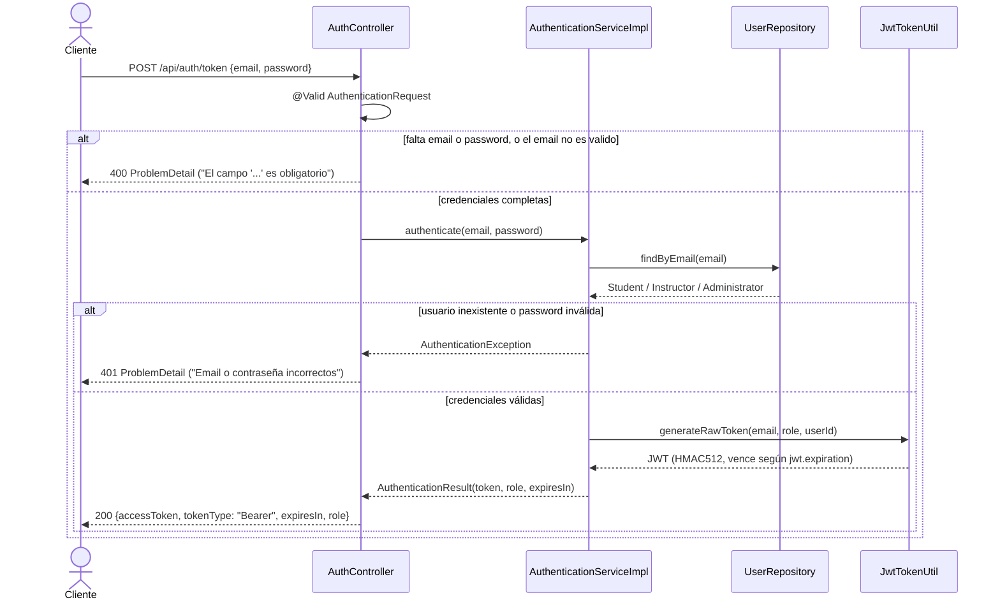

# Login único (`POST /api/auth/token`)

El mismo endpoint autentica a alumnos, instructores y administradores. Busca el email en la
tabla base `users` (con la herencia JOINED vuelve el `Student`, `Instructor` o `Administrator`), toma el rol de
`User.getRole()` y firma el JWT con ese rol. No hay columna `rol` en la base.

## Uso del token

- El cliente arma el header `Authorization: Bearer <accessToken>`.
- En Swagger UI se pega ese mismo valor completo en el botón **Authorize**.
- En Postman la colección guarda `Bearer <accessToken>` en `tokenAdmin`, `tokenInstructor`, etc.
- El claim `rol` del token lleva `ALUMNO`, `INSTRUCTOR` o `ADMINISTRADOR` (lo que lee el front); el campo
  `role` de la respuesta va en inglés.
- Los logins por rol del TP6 (`/students/auth`, `/auth`, `/admin/auth`) siguen igual. Los viejos
  (`/student/auth`, `/instructor/auth`, `/administrator/auth`) siguen funcionando pero están deprecados. Todos
  devuelven el token con el prefijo incluido.
