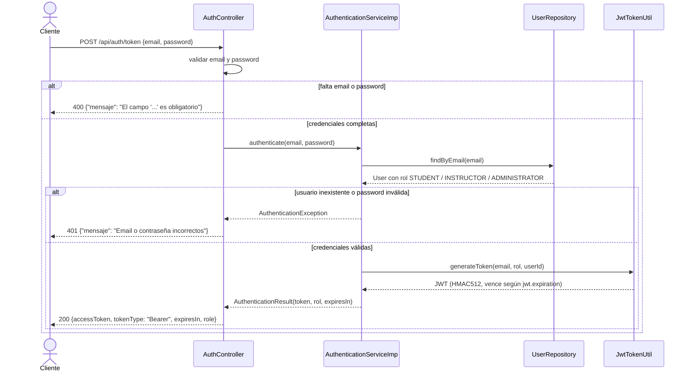

# Login único (`POST /api/auth/token`)

El mismo endpoint autentica a alumnos, instructores y administradores. Busca el email en la
tabla base `users`, detecta el rol guardado en `User.rol` y firma el JWT con ese rol.

## Uso del token

- El cliente arma el header `Authorization: Bearer <accessToken>`.
- En Swagger UI se pega ese mismo valor completo en el botón **Authorize**.
- En Postman la colección guarda `Bearer <accessToken>` en `tokenAdmin`, `tokenInstructor`, etc.
- Los logins viejos (`/student/auth`, `/instructor/auth`, `/administrator/auth`) siguen
  funcionando pero están deprecados y devuelven el token con el prefijo incluido.
